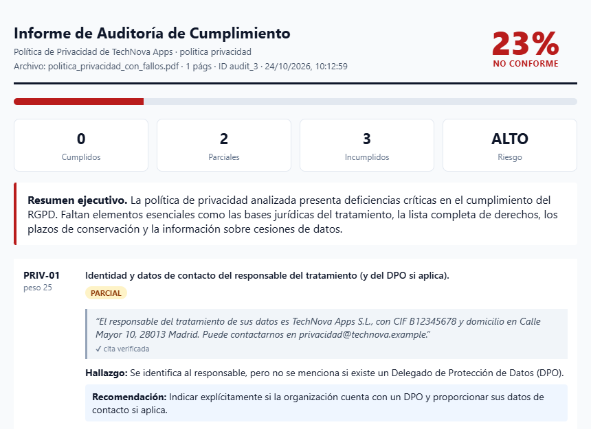
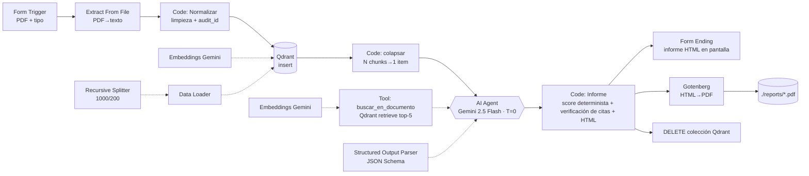

# 🛡️ AI Compliance Auditor — n8n · RAG · Qdrant · Gemini

    

Sistema que audita un PDF (política de privacidad, contrato o SRS) contra una checklist normativa y devuelve un **informe ejecutivo** con puntuación de cumplimiento, citas **literales verificadas**, infracciones y recomendaciones. Coste: **0 €** con el free tier de Gemini.



## Arquitectura



| # | Nodo n8n | Tipo | Función |
|---|----------|------|---------|
| 1 | Formulario PDF | `Form Trigger` | Subida del PDF + tipo de documento + email |
| 2 | Extraer texto PDF | `Extract From File` (PDF) | Binario → texto |
| 3 | Normalizar texto | `Code` | Limpieza, une guiones, límite 200k chars, falla si PDF escaneado, `audit_id` |
| 4 | Indexar en Qdrant | `Qdrant Vector Store` (insert) | Colección efímera `audit_<executionId>` → aislamiento entre auditorías |
| 4a | Embeddings Gemini | `Embeddings Google Gemini` | `gemini-embedding-001` |
| 4b | Data Loader + Chunking | `Default Data Loader` + `Recursive Character Text Splitter` | Chunks 1000 / overlap 200 + metadatos |
| 5 | Preparar contexto agente | `Code` | Colapsa N items (1/chunk) a 1 → el agente se ejecuta una vez |
| 6 | Agente Auditor | `AI Agent` | System prompt estricto, `maxIterations` 20, reintento |
| 6a | Gemini 2.5 Flash | `Google Gemini Chat Model` | temperature 0 |
| 6b | buscar_en_documento | `Qdrant Vector Store` (retrieve-as-tool) | Tool RAG top-5 |
| 6c | Schema JSON informe | `Structured Output Parser` | JSON Schema con enums → salida tipada |
| 7 | Construir informe | `Code` | **Guardarraíles**: verifica cada cita contra el texto original; si `cumple` sin cita verificable → degrada a `parcial`. Score ponderado determinista. HTML + texto Slack |
| 8 | Mostrar informe | `Form` (ending, Show Text) | El usuario ve el informe en el navegador |
| 9 | HTML a PDF + Guardar | `HTTP Request` → Gotenberg + `Read/Write Files` | PDF en `./reports` |
| 10 | Borrar colección Qdrant | `HTTP Request` DELETE | Sin residuos (privacidad) |

### Decisiones de diseño (lo que destaca en una entrevista)
- **LLM juzga, código puntúa**: el modelo solo decide `cumple/parcial/no_cumple`; la puntuación la calcula JS → reproducible, sin errores aritméticos.
- **Anti-alucinación en 3 capas**: prompt (solo tool como fuente) → schema con enums → verificación literal de citas post-LLM.
- **Aislamiento multi-tenant**: colección por ejecución + borrado al final.
- **Fuente única de verdad**: prompts y JS viven en `prompts/` y `code/`; `scripts/build_workflow.py` genera el JSON importable. Tests offline en `scripts/test_code_nodes.mjs` (incluye el caso de cita inventada → degradación).

## Dos variantes

| Workflow | Vector DB | PDF del informe | Infra | Uso |
|---|---|---|---|---|
| `workflows/compliance_auditor_lite.json` | Simple Vector Store (memoria n8n) | Ctrl+P en el informe | **Ninguna** (cualquier n8n) | Demo rápida / n8n Cloud |
| `workflows/compliance_auditor.json` | **Qdrant** (colección efímera) | Gotenberg → `./reports` | `docker compose` | Versión completa |

## Puesta en marcha (≈20 min)

### Rápida (LITE, sin Docker)
1. n8n → Import from File → `workflows/compliance_auditor_lite.json`.
2. Crea credencial **Google Gemini (PaLM) API** (key gratis de AI Studio) y asígnala a los 3 nodos Gemini.
3. Activa el workflow → abre la *Production URL* del Formulario PDF.


### 0. Requisitos
Docker + Docker Compose. Clave gratis de Gemini: <https://aistudio.google.com/apikey>.

### 1. Levantar stack
```bash
cp .env.example .env            # pon una N8N_ENCRYPTION_KEY aleatoria: openssl rand -hex 32
docker compose up -d
```
- n8n → <http://localhost:5678> (crea usuario owner)
- Qdrant dashboard → <http://localhost:6333/dashboard>

### 2. Importar workflow
n8n → **Workflows → Create → ⋯ → Import from File** → `workflows/compliance_auditor.json`.

### 3. Credenciales (2)
| Credencial | Dónde | Valores |
|---|---|---|
| **Google Gemini (PaLM) API** | nodos *Gemini 2.5 Flash*, *Embeddings Gemini (indexado)*, *Embeddings Gemini (consulta)* | Host `https://generativelanguage.googleapis.com` · API Key de AI Studio |
| **Qdrant API** | nodos *Indexar en Qdrant*, *buscar_en_documento* | URL `http://qdrant:6333` · API key vacía |

Abre cada nodo con ⚠️ y selecciona la credencial.

### 4. Probar
1. Abre *Formulario PDF* → **Test step** (o activa el workflow y usa la *Production URL*).
2. Sube `samples/politica_privacidad_con_fallos.pdf` → tipo *Política de privacidad (RGPD)*.
3. Esperado: ~40-60 %, fallos en PRIV-03/04/05. Con `samples/politica_privacidad_conforme.pdf` → ≥85 %.
4. PDF del informe en `./reports/`.

### 5. Publicarlo (demo pública hoy)
| Opción | Coste | Cómo |
|---|---|---|
| **Cloudflare Tunnel** (recomendado) | 0 € | `cloudflared tunnel --url http://localhost:5678` → copia URL en `WEBHOOK_URL` del `.env` → `docker compose up -d` |
| VPS (Hetzner CX22 / Oracle Free Tier) | 0-4 €/mes | Mismo `docker-compose.yml` + Caddy para HTTPS |
| n8n Cloud trial | 0 € 14 días | Importa JSON; sustituye Qdrant por **Qdrant Cloud free (1 GB)** y quita la rama Gotenberg |

> Activa el workflow (toggle *Active*) y comparte la **Production URL** del formulario en LinkedIn.

## Alternativas de modelo
- **OpenAI**: sustituye *Gemini 2.5 Flash* por `OpenAI Chat Model` (`gpt-4o-mini`) y ambos embeddings por `Embeddings OpenAI` (`text-embedding-3-small`). ⚠️ No mezcles modelos de embeddings entre indexado y consulta.
- **Sin Docker para la DB**: cambia los dos nodos Qdrant por `Simple Vector Store` (memoria) con la misma *Memory Key* `={{ $execution.id }}` y elimina *Borrar colección Qdrant*.
- `gemini-1.5-flash` está retirado; usa `gemini-2.5-flash` / `gemini-2.5-flash-lite`.

## Optimización de costes
| Palanca | Implementación |
|---|---|
| Free tier Gemini | AI Studio sin tarjeta: Flash + embeddings gratis con límites RPM/RPD. Coste real ≈ 0 € |
| Embeddings baratos | Un doc de 20 págs ≈ 60 chunks ≈ 15k tokens. Con `text-embedding-3-small` ≈ 0,0003 € |
| Tope de tamaño | `MAX_CHARS = 200000` en *Normalizar texto* |
| Contexto mínimo | RAG top-5 × 1000 chars en vez de mandar el documento entero (~5x menos tokens de entrada por consulta) |
| Iteraciones acotadas | `maxIterations: 20`, `maxOutputTokens: 4096`, `temperature: 0` |
| Batch de embeddings | `embeddingBatchSize: 50` → menos peticiones → no golpeas el límite RPM |
| Rate limits (429) | Reintento en el agente (2 intentos, 5 s). Si persiste, usa `gemini-2.5-flash-lite` (más cuota) |
| Sin coste de infra | Todo local en Docker; Qdrant/Gotenberg self-hosted |
| Privacidad | ⚠️ El free tier de Gemini puede usar los datos para mejorar productos: usa solo documentos públicos/de prueba |

Estimación con OpenAI de pago (gpt-4o-mini, $0,15/M in · $0,60/M out): ~25k in + 3k out ≈ **0,006 $ por auditoría**.

## Estructura
```
├── docker-compose.yml       n8n + Qdrant + Gotenberg
├── workflows/
│   ├── compliance_auditor.json       ← versión Qdrant + Gotenberg (GENERADO)
│   └── compliance_auditor_lite.json  ← versión sin infra (GENERADO)
├── prompts/                 system + user prompt del agente
├── code/                    JS de los 3 nodos Code
├── scripts/
│   ├── build_workflow.py    genera los JSON desde prompts/ y code/
│   ├── test_code_nodes.mjs  tests offline (node scripts/test_code_nodes.mjs)
│   └── make_samples.py      PDFs de demo
├── samples/                 PDFs de prueba
└── docs/                    informe de ejemplo + post de LinkedIn
```

## Desarrollo
```bash
node scripts/test_code_nodes.mjs     # 11 tests de los nodos Code (sin n8n)
python scripts/build_workflow.py     # regenera workflows/*.json tras editar prompts/ o code/
python scripts/make_samples.py       # regenera PDFs de muestra (requiere reportlab)
```

## Extensiones (roadmap)
- Slack: tras *Construir informe* añade nodo `Slack → Send Message` con `={{ $json.slack_text }}`.
- Email: `Gmail → Send` a `={{ $json.email }}` adjuntando binario `pdf`.
- Error Workflow con `Error Trigger` para borrar la colección si falla el agente.
- Evaluaciones: dataset de PDFs etiquetados + n8n *Evaluations* para medir precisión por criterio.
- OCR (Mistral OCR / Tesseract) para PDFs escaneados.

> ⚖️ Herramienta de apoyo; no constituye asesoramiento legal.
